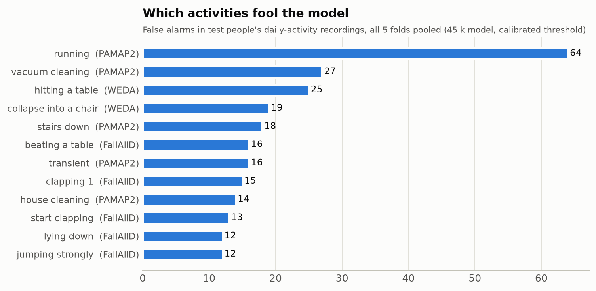

# False alarms: where they come from and what they mean for the band

Model: the 45 k Sanad-Tiny on the band, decision threshold 0.282 (calibrated to catch
95% of falls end to end). All numbers are
out-of-fold: every person was scored by a model that never saw them.

## 1. A false alarm needs two things: the trigger fires, then the model says "fall"

| data | hours | triggers_per_h | share_flagged | false_alarms_per_h |
|---|---|---|---|---|
| fallalld | 11.1 | 189.1 | 9.3% | 17.5 |
| pamap2 | 10.1 | 224.1 | 8.1% | 18.1 |
| weda_fall | 1.8 | 439.1 | 12.5% | 55.0 |
| weda elderly (77-95) | 0.5 | 337.7 | 8.2% | 27.5 |

The datasets' daily-activity clips are short, back-to-back recordings of exactly the movements
that set off the trigger (clapping, banging a table, jumping, sitting down hard), so the trigger
fires **hundreds of times per hour** in them. The model rejects most of those; the false alarms
per hour are what's left. That's a stress test, not a day in someone's life.

## 2. What fools the model

## 3. A rough real-life estimate: this is the real problem

PAMAP2 has minutes-long sessions of everyday activities (young adults). By activity group:

| activity group | hours | triggers_per_h | false_alarms_per_h |
|---|---|---|---|
| sitting, lying, TV, driving | 2.6 | 12.5 | 3.0 |
| household chores | 1.8 | 228.6 | 25.9 |
| walking, stairs | 1.3 | 214.0 | 15.6 |
| sport (not in an elderly day) | 1.4 | 897.7 | 65.4 |

For an illustrative 16 h waking day of an older person living alone
(12 h sitting, lying, TV, driving, 2 h household chores, 2 h walking, stairs) the trigger would fire about
**1036 times**, and the model at today's threshold would let through about
**120 false alarms per day**. The trade-off with the threshold:

| falls_caught | threshold | false_alarms_per_day |
|---|---|---|
| 95.0% | 0.282 | 120 |
| 90.0% | 0.615 | 59 |
| 85.0% | 0.773 | 39 |
| 80.0% | 0.861 | 20 |
| 70.0% | 0.943 | 4 |

The approval-form target is **≤ 2 false alarms per 24 h**. No threshold gets there while still
catching most falls, so the trigger + model alone are **not enough**: people would quickly learn to
ignore the band. (PAMAP2's people are young and brisk, which inflates chores and stairs; treat this
as an order of magnitude until the band measures it.)

## 4. A stillness check after the impact

After a real fall the wrist mostly stays still; after clapping, vacuuming or going downstairs it
keeps moving. For everything the model flags, look at the next few seconds after the window
(variation of |a| and mean rotation speed) and only continue if the wrist is still. Best setting
per check length that keeps ≥ 95 % of falls (falls where the person gets back up are left out:
they don't need an emergency call):

| seconds_checked | falls | false_alarms | a_std_max_g | gyro_mean_max_dps | falls_kept | false_alarms_removed |
|---|---|---|---|---|---|---|
| 3.0 | 628.0 | 395.0 | 0.30 | 80 | 96.7% | 57.5% |
| 5.0 | 506.0 | 348.0 | 0.30 | 60 | 95.7% | 66.4% |
| 8.0 | 341.0 | 322.0 | 0.30 | 60 | 96.2% | 67.4% |

Longer checks are only possible on fewer recordings (most public fall clips end a few seconds after
the impact), so the 8 s row rests mostly on FallAllD. Real fall-detection watches wait much longer
(around a minute without movement) before calling for help; public data can't test that, the band can.

## 5. What this means for Sanad

1. **Don't ring on the model alone.** Model says "fall" → wait for stillness → only then start the
   30 s countdown. Everything that keeps moving (most false alarms) never makes a sound.
2. **Make the first step quiet.** A short vibration ("did you fall?") before the loud alarm costs
   almost nothing when it's wrong.
3. **Collect the band's own "normal day" data.** A few days of wear by the team and grandparents,
   with every trigger logged, turns stairs, chores and prayer movements into training examples.
   The datasets' worst offenders (stairs down, vacuuming, chores, collapsing into a chair) are
   exactly what the band will see.
