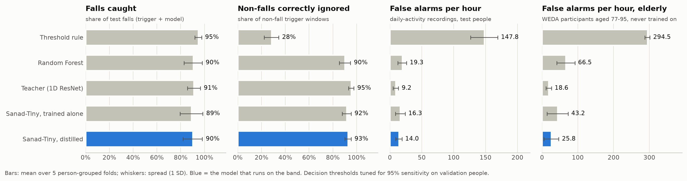

# Sanad fall detection: results

Cross-validation run `cv_v1`: 5 folds split **by person** (nobody is in both training and test),
over FallAllD, WEDA-FALL and PAMAP2. WEDA's 11 participants aged 77–95 are never trained on and form
a separate "elderly" test. Every number below comes from people the model never saw.

## Test people (falls and daily activities)

| Approach | Falls caught (event) | Sensitivity (window) | Specificity (window) | F1 | AUC | False alarms / hour |
|---|---|---|---|---|---|---|
| Threshold rule | 94.7% ± 2.8% | 96.0% ± 1.7% | 28.4% ± 6.0% | 0.35 ± 0.12 | 0.83 ± 0.07 | 147.80 ± 21.40 |
| Random Forest | 90.5% ± 7.6% | 91.6% ± 6.7% | 90.1% ± 4.7% | 0.76 ± 0.10 | 0.97 ± 0.01 | 19.28 ± 6.86 |
| Teacher (1D ResNet) | 91.1% ± 5.4% | 92.2% ± 4.4% | 95.5% ± 2.2% | 0.85 ± 0.10 | 0.99 ± 0.01 | 9.18 ± 4.27 |
| Sanad-Tiny, trained alone | 89.0% ± 9.5% | 90.0% ± 8.6% | 91.6% ± 3.8% | 0.77 ± 0.11 | 0.97 ± 0.02 | 16.34 ± 7.62 |
| **Sanad-Tiny, distilled** | 90.1% ± 8.1% | 91.2% ± 7.1% | 92.7% ± 2.6% | 0.79 ± 0.12 | 0.97 ± 0.03 | 13.98 ± 4.96 |

"Falls caught" counts a fall only if the trigger fired at the impact **and** the model said fall, so
falls the trigger missed count as misses. Window metrics score only the windows the trigger produced.

## Elderly participants (daily activities only, never trained on)

| Approach | Specificity (window) | False alarms / hour |
|---|---|---|
| Threshold rule | 12.8% ± 2.0% | 294.46 ± 7.21 |
| Random Forest | 80.3% ± 7.4% | 66.52 ± 25.19 |
| Teacher (1D ResNet) | 94.5% ± 2.3% | 18.64 ± 7.63 |
| Sanad-Tiny, trained alone | 87.2% ± 8.8% | 43.22 ± 29.52 |
| **Sanad-Tiny, distilled** | 92.3% ± 6.2% | 25.84 ± 20.82 |

## Reading the numbers

- **Targets:** the approval form asks for ≥ 90 % sensitivity and ≥ 90 % specificity on unseen people.
  The distilled Sanad-Tiny meets both in cross-validation, with little margin on sensitivity.
- **False alarms per hour are a worst case.** The daily-activity recordings are short, dense clips
  of the hardest movements (jogging, jumping, clapping, banging a table, rope jumping, sitting down
  hard): the trigger fires about 170–310 times per hour of them. Ordinary days have far fewer
  impacts, and every remaining false alarm still has to survive the 30 s "I'm OK" countdown. The
  real-life rate has to be measured with the band (target: ≤ 2 per 24 h).
- **Distillation pays off where it matters:** compared with the same small network trained alone,
  the distilled one catches slightly more falls and gives far fewer false alarms on the elderly.
- **Spread between folds is large** (± several points): only ~35 people, and some folds are mostly
  one dataset. Data from the real band (Phase 4) is the biggest expected improvement.

## Setup

- Trigger threshold per fold (≥ 99 % of training falls): 2.27–2.34 g
- Teacher: 942,625 parameters, 39.2 M MACs per window
- Sanad-Tiny: 11,825 parameters, 0.72 M MACs per window
- Decision thresholds picked on validation people for 95 % sensitivity, then applied unchanged to test people.
- Augmentation: random rotation (±25°), any roll around the forearm, left/right mirroring, gain, time shift, noise.

## Final model on the band (trained on all data, exported for the Pico 2 W)

Chosen by the student-size tournament (`reports/student_size.md`): Sanad-Tiny with widths
[32, 64, 128] distilled from the transformer teacher. Its
decision threshold is calibrated on pooled out-of-fold predictions to catch
95% of falls end to end.

| | Value |
|---|---|
| Trigger threshold | 2.30 g |
| Decision threshold | fall if probability ≥ 0.282 |
| Sanad-Tiny size | 45,153 parameters, 2.57 M MACs, 59.3 KB int8 |
| Teacher size | 549,249 parameters |
| **Out-of-fold, all 5 folds pooled** (the honest estimate) | falls caught 95.1%, specificity 90.8%, false alarms 18.9/h of hard daily activity, elderly 27.5/h |
| Validation, float | sensitivity 96.5%, specificity 97.4%, AUC 0.996 |
| Validation, int8 (what the band runs) | sensitivity 96.5%, specificity 97.3%, AUC 0.996 |
| TFLite ops | CONV_2D, EXPAND_DIMS, FULLY_CONNECTED, LOGISTIC, MAX_POOL_2D, MEAN, RESHAPE |

The validation rows come from only a handful of held-out people, so they run higher than the
out-of-fold row; quote the out-of-fold numbers. **False alarms are the open problem:** see
`reports/false_alarms.md` (≈ 120 per normal day estimated at this threshold; the band needs a
post-fall stillness check and its own recordings).

Files: `models/sanad_tiny_int8.tflite`, `models/firmware/sanad_model_data.cc/.h`,
`models/firmware/sanad_model_config.h`.
