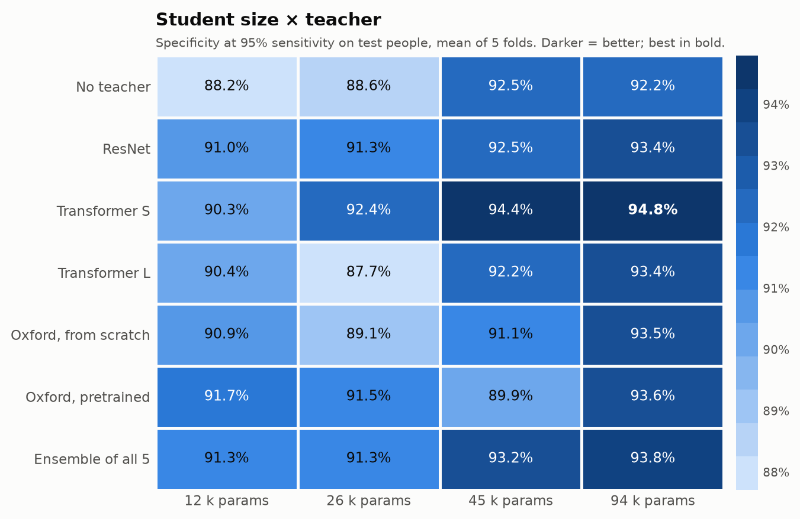
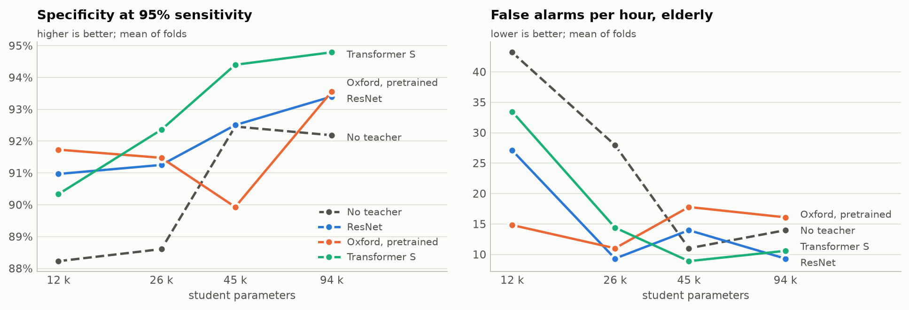

# Student-size tournament

Run `size_v1`: 5 person-grouped folds, the same people and teachers as the
teacher tournament. Every Sanad-Tiny size is trained with no teacher and distilled from every
teacher (recipe `standard`: half labels, half teacher, T = 2). 28 contenders in total.

## Findings

1. **A bigger student helps more than a fancier teacher.** Without any teacher, going from 12 k to
   45 k parameters lifts specificity at 95 % sensitivity from 88.2 % to 92.5 %. The best student
   overall is the 94 k one at **94.8 %** (12 k today: 91.0 % with the ResNet teacher, 91.7 % at best).
2. **Distillation still helps at every size.** The best distilled student beats the same size
   without a teacher by +3.5, +3.8, +1.9 and +2.6 points (12 k → 94 k), and cuts false alarms on
   the elderly (e.g. 12 k: 43.2 → 14.8 per hour; 45 k: 11.0 → 8.9).
3. **The best teacher doesn't make the best student.** The small transformer was the *weakest*
   teacher (90.0 %) but taught the best 26 k, 45 k and 94 k students; the Oxford pretrained teacher
   only won at 12 k. Fold-to-fold spread is ±3–5 points, so among teachers at a given size most
   gaps are noise; the solid conclusions are "bigger student" and "use a teacher".
4. **45 k is the sweet spot.** 94.4 % (transformer S teacher) for 59 KB of flash, ~13 KB of RAM and
   an estimated 29–69 ms per inference. Doubling to 94 k adds only +0.4 points for twice the compute,
   and its slow-end estimate (142 ms) passes the 100 ms target.
5. **The decision threshold needs better calibration before deployment.** Thresholds picked on
   the small validation sets for 95 % sensitivity catch only ~87–89 % of test falls with the bigger
   students (90.1 % for today's 12 k). The model can do better (that's what the 95 %-sensitivity
   column shows); the threshold is being set from too few validation falls.

**Recommendation for the band:** a 45 k Sanad-Tiny distilled from the small transformer (licence-
free, no Oxford weights involved), with its decision threshold calibrated on pooled out-of-fold
predictions instead of one small validation set.

## Specificity at 95% sensitivity (test people)

| Teacher | 12 k | 26 k | 45 k | 94 k |
|---|---|---|---|---|
| No teacher | 88.2% | 88.6% | 92.5% | 92.2% |
| ResNet | 91.0% | 91.3% | 92.5% | 93.4% |
| Transformer S | 90.3% | 92.4% | 94.4% | 94.8% |
| Transformer L | 90.4% | 87.7% | 92.2% | 93.4% |
| Oxford, from scratch | 90.9% | 89.1% | 91.1% | 93.5% |
| Oxford, pretrained | 91.7% | 91.5% | 89.9% | 93.6% |
| Ensemble of all 5 | 91.3% | 91.3% | 93.2% | 93.8% |

## False alarms per hour, elderly participants (never trained on)

| Teacher | 12 k | 26 k | 45 k | 94 k |
|---|---|---|---|---|
| No teacher | 43.2 | 28.0 | 11.0 | 14.0 |
| ResNet | 27.1 | 9.3 | 14.0 | 9.3 |
| Transformer S | 33.5 | 14.4 | 8.9 | 10.6 |
| Transformer L | 27.5 | 15.3 | 14.4 | 6.4 |
| Oxford, from scratch | 27.1 | 20.3 | 18.2 | 17.4 |
| Oxford, pretrained | 14.8 | 11.0 | 17.8 | 16.1 |
| Ensemble of all 5 | 23.3 | 22.9 | 12.7 | 8.5 |

## Falls caught (decision threshold from validation people)

| Teacher | 12 k | 26 k | 45 k | 94 k |
|---|---|---|---|---|
| No teacher | 89.0% | 87.9% | 87.7% | 87.0% |
| ResNet | 90.1% | 87.4% | 88.7% | 89.0% |
| Transformer S | 89.1% | 89.3% | 88.1% | 87.2% |
| Transformer L | 89.0% | 88.4% | 88.8% | 88.2% |
| Oxford, from scratch | 88.4% | 87.2% | 87.0% | 87.3% |
| Oxford, pretrained | 88.5% | 86.2% | 88.0% | 87.5% |
| Ensemble of all 5 | 89.7% | 91.0% | 88.2% | 87.3% |

## Cost on the Raspberry Pi Pico 2 W

| Student | MACs per window | int8 model (flash) | RAM for activations | Inference time (estimate) |
|---|---|---|---|---|
| 11.8 k | 0.72 M | 22 KB | ~9 KB | 8–19 ms |
| 25.8 k | 1.51 M | 38 KB | ~11 KB | 17–40 ms |
| 45.2 k | 2.57 M | 59 KB | ~13 KB | 29–69 ms |
| 93.8 k | 5.33 M | 109 KB | ~18 KB | 59–142 ms |

Pico 2 W: 4 MB flash, 520 KB RAM, Cortex-M33 at 150 MHz. All sizes use only these TFLite Micro
operators: CONV_2D, EXPAND_DIMS, FULLY_CONNECTED, LOGISTIC, MAX_POOL_2D, MEAN, RESHAPE. Times are a range for typical CMSIS-NN int8 speed
(0.25–0.6 multiply-accumulates per clock) and must be measured on the board; the model runs only
after a trigger, so it costs almost no battery.

## Full round-robin standings (all 28 students)

| Rank | Contender | Points | Params | Specificity @ 95% sens. | AUC | Falls caught | Specificity | False alarms/h | Elderly false alarms/h |
|---|---|---|---|---|---|---|---|---|---|
| 1 | transformer_small/standard@s100k | 27 | 93.8 k | 94.8% ± 3.6% | 0.99 ± 0.01 | 87.2% ± 12.9% | 96.2% ± 2.7% | 6.64 ± 4.43 | 10.59 ± 19.09 |
| 2 | transformer_small/standard@s50k | 25.5 | 45.2 k | 94.4% ± 3.4% | 0.99 ± 0.01 | 88.1% ± 12.0% | 95.4% ± 2.3% | 8.10 ± 3.55 | 8.90 ± 10.92 |
| 3 | ensemble/standard@s100k | 25.5 | 93.8 k | 93.8% ± 4.6% | 0.99 ± 0.01 | 87.3% ± 10.3% | 96.0% ± 3.0% | 6.97 ± 4.10 | 8.47 ± 10.63 |
| 4 | oxford_pretrained/standard@s100k | 24 | 93.8 k | 93.6% ± 3.3% | 0.98 ± 0.01 | 87.5% ± 10.9% | 94.3% ± 2.6% | 10.59 ± 4.63 | 16.10 ± 26.03 |
| 5 | oxford_scratch/standard@s100k | 23 | 93.8 k | 93.5% ± 5.0% | 0.98 ± 0.02 | 87.3% ± 10.2% | 94.5% ± 3.3% | 9.72 ± 5.78 | 17.37 ± 21.03 |
| 6 | transformer_large/standard@s100k | 22 | 93.8 k | 93.4% ± 5.5% | 0.99 ± 0.01 | 88.2% ± 10.7% | 95.6% ± 4.0% | 7.66 ± 5.79 | 6.36 ± 6.28 |
| 7 | resnet/standard@s100k | 20 | 93.8 k | 93.4% ± 4.7% | 0.98 ± 0.01 | 89.0% ± 9.0% | 95.8% ± 1.8% | 7.96 ± 3.37 | 9.32 ± 8.32 |
| 8 | ensemble/standard@s50k | 20 | 45.2 k | 93.2% ± 5.0% | 0.98 ± 0.01 | 88.2% ± 10.6% | 94.6% ± 2.5% | 9.92 ± 4.26 | 12.71 ± 14.98 |
| 9 | resnet/standard@s50k | 18 | 45.2 k | 92.5% ± 5.8% | 0.98 ± 0.02 | 88.7% ± 8.9% | 93.2% ± 3.0% | 13.06 ± 5.76 | 13.98 ± 13.70 |
| 10 | resnet/standard@s12k | 16 | 11.8 k | 91.0% ± 7.4% | 0.97 ± 0.03 | 90.1% ± 8.1% | 93.0% ± 2.7% | 13.49 ± 5.27 | 27.12 ± 20.82 |
| 11 | none@s100k | 15.5 | 93.8 k | 92.2% ± 3.5% | 0.98 ± 0.01 | 87.0% ± 11.2% | 94.4% ± 3.4% | 10.57 ± 6.76 | 13.98 ± 17.14 |
| 12 | transformer_small/standard@s25k | 15 | 25.8 k | 92.4% ± 5.1% | 0.98 ± 0.01 | 89.3% ± 8.5% | 94.5% ± 2.1% | 9.92 ± 2.40 | 14.41 ± 13.29 |
| 13 | oxford_pretrained/standard@s12k | 15 | 11.8 k | 91.7% ± 6.5% | 0.98 ± 0.02 | 88.5% ± 10.9% | 94.7% ± 3.6% | 9.36 ± 5.20 | 14.83 ± 12.35 |
| 14 | transformer_large/standard@s25k | 15 | 25.8 k | 87.7% ± 11.4% | 0.97 ± 0.03 | 88.4% ± 9.0% | 94.5% ± 1.9% | 10.42 ± 5.19 | 15.25 ± 13.22 |
| 15 | none@s50k | 13 | 45.2 k | 92.5% ± 3.9% | 0.98 ± 0.01 | 87.7% ± 11.1% | 94.4% ± 1.8% | 9.76 ± 1.70 | 11.02 ± 8.52 |
| 16 | ensemble/standard@s12k | 11 | 11.8 k | 91.3% ± 5.1% | 0.98 ± 0.01 | 89.7% ± 7.3% | 93.7% ± 2.1% | 10.97 ± 2.85 | 23.30 ± 17.62 |
| 17 | oxford_scratch/standard@s12k | 11 | 11.8 k | 90.9% ± 6.8% | 0.97 ± 0.02 | 88.4% ± 9.8% | 92.6% ± 2.3% | 13.94 ± 4.23 | 27.12 ± 28.47 |
| 18 | transformer_large/standard@s50k | 10 | 45.2 k | 92.2% ± 4.4% | 0.98 ± 0.02 | 88.8% ± 10.8% | 93.6% ± 2.8% | 11.86 ± 4.86 | 14.41 ± 18.14 |
| 19 | oxford_pretrained/standard@s25k | 10 | 25.8 k | 91.5% ± 4.1% | 0.98 ± 0.02 | 86.2% ± 9.0% | 95.1% ± 1.8% | 9.27 ± 4.28 | 11.02 ± 13.95 |
| 20 | oxford_scratch/standard@s50k | 10 | 45.2 k | 91.1% ± 6.6% | 0.98 ± 0.01 | 87.0% ± 10.5% | 94.4% ± 3.0% | 9.99 ± 5.23 | 18.22 ± 16.33 |
| 21 | resnet/standard@s25k | 8 | 25.8 k | 91.3% ± 4.9% | 0.98 ± 0.02 | 87.4% ± 8.8% | 94.2% ± 2.2% | 11.25 ± 4.83 | 9.32 ± 6.78 |
| 22 | ensemble/standard@s25k | 6 | 25.8 k | 91.3% ± 4.5% | 0.98 ± 0.02 | 91.0% ± 5.4% | 93.1% ± 2.8% | 12.90 ± 3.84 | 22.88 ± 17.44 |
| 23 | transformer_large/standard@s12k | 6 | 11.8 k | 90.4% ± 6.2% | 0.98 ± 0.02 | 89.0% ± 9.8% | 92.3% ± 4.0% | 14.27 ± 6.48 | 27.54 ± 27.46 |
| 24 | oxford_scratch/standard@s25k | 4 | 25.8 k | 89.1% ± 6.8% | 0.98 ± 0.02 | 87.2% ± 7.7% | 94.2% ± 1.6% | 10.45 ± 3.66 | 20.34 ± 7.65 |
| 25 | transformer_small/standard@s12k | 3.5 | 11.8 k | 90.3% ± 5.4% | 0.98 ± 0.01 | 89.1% ± 8.7% | 92.7% ± 2.6% | 14.04 ± 5.46 | 33.47 ± 28.08 |
| 26 | none@s12k | 3 | 11.8 k | 88.2% ± 8.8% | 0.97 ± 0.02 | 89.0% ± 9.5% | 91.6% ± 3.8% | 16.34 ± 7.62 | 43.22 ± 29.52 |
| 27 | oxford_pretrained/standard@s50k | 1 | 45.2 k | 89.9% ± 4.6% | 0.98 ± 0.02 | 88.0% ± 8.6% | 93.7% ± 2.2% | 11.89 ± 4.75 | 17.79 ± 18.59 |
| 28 | none@s25k | 0 | 25.8 k | 88.6% ± 3.1% | 0.97 ± 0.01 | 87.9% ± 9.3% | 93.2% ± 3.4% | 12.74 ± 6.22 | 27.96 ± 36.46 |

---
Oxford harnet5 teacher: Copyright © 2022, University of Oxford (Academic Use Licence; students
distilled from it inherit it: fine for this non-commercial capstone, not for a product for sale).
