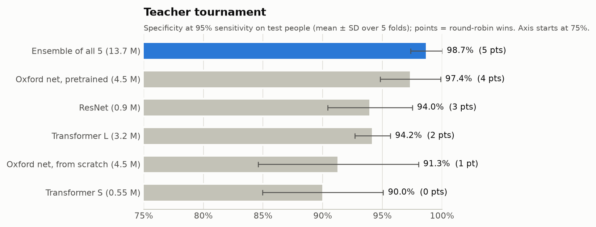
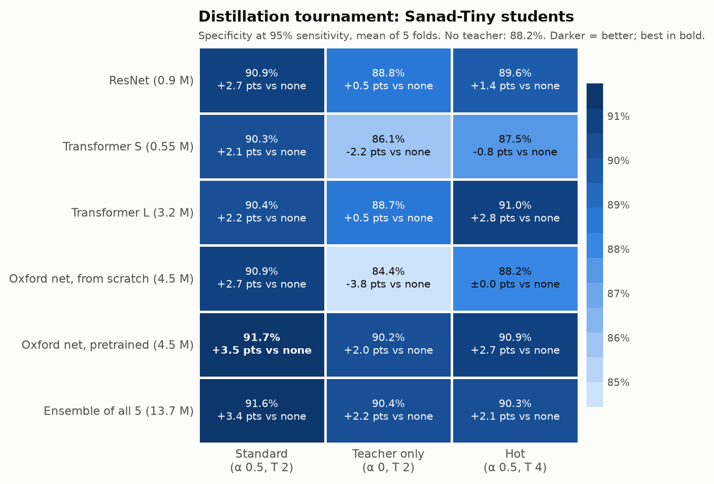

# Teacher and distillation tournament

Run `tournament_v1`: 5 person-grouped folds, the same people, windows and augmentation as
`cv_v1` (FallAllD + WEDA-FALL + PAMAP2; WEDA's 77–95-year-olds held out as the elderly test).
Every contender is ranked by a round robin on **specificity at 95% sensitivity on test people**:
in each pairing, whoever is better on more folds wins the match (1 point; a draw is 0.5).

## Findings

1. **A heavy transformer did not beat the plain ResNet.** The large transformer (3.2 M parameters)
   tied the ResNet teacher (94.2 % vs 94.0 % specificity at 95 % sensitivity) with 3.4× the
   parameters; the small one (0.55 M) came last (90.0 %). With ~35 people of data, model size is
   not what limits the teacher.
2. **Pretraining on big data did.** The *same* Oxford network went from 91.3 % (trained from
   scratch on our data) to **97.4 %** when it started from weights learned on 700,000 person-days of
   UK Biobank wrist data, and its false alarms on the elderly dropped from 32.6 to 2.1 per hour.
   The ensemble of all five teachers was best overall (98.7 %, no elderly false alarms).
3. **A much better teacher makes only a slightly better student.** The 3.4-point gap between the
   Oxford and ResNet teachers shrinks to 0.8 points between their students (91.7 % vs 90.9 %), and
   the top three students are within fold-to-fold noise (± ~6 points). Sanad-Tiny's 11.8 k
   parameters are now the bottleneck, not the teacher.
4. **Where the better teacher does show: false alarms.** The Oxford-distilled student gave 9.4
   false alarms per hour of hard daily activity (ResNet-distilled: 13.7, no teacher: 16.3) and 14.8
   on the elderly (24.6 and 43.2). At the validation-picked threshold it caught slightly fewer falls
   (88.5 % vs 90.2 %), so its threshold would need re-tuning; at equal sensitivity it is better.
5. **Recipe: half labels, half teacher (`standard`, T = 2) won for 5 of 6 teachers.** Learning from
   the teacher alone (`teacher_only`) was the worst recipe for 5 of 6, and a weak teacher can hurt:
   the from-scratch Oxford teacher with `teacher_only` (84.4 %) did worse than no teacher (88.2 %).

**Answer to "train a heavy model, then distil it":** a bigger architecture alone doesn't help; a
teacher that has *seen far more data* does, and it mainly cuts false alarms. To turn more of the
teacher's advantage into the band, the next levers are a somewhat larger student (Pico 2 W has room
for 25–50 k parameters) and real recordings from the band.

**Licence note:** the winning student is distilled from Oxford's weights, so it inherits their
Academic Use Licence (fine for the capstone with credit; not for a product for sale). The
ResNet-distilled student currently exported to `models/` has no such restriction.

## Teacher tournament

| Rank | Contender | Points | Params | Specificity @ 95% sens. | AUC | Falls caught | Specificity | False alarms/h | Elderly false alarms/h |
|---|---|---|---|---|---|---|---|---|---|
| 1 | ensemble | 5 | 13.68 M | 98.7% ± 1.3% | 1.00 ± 0.00 | 88.2% ± 7.8% | 99.1% ± 1.0% | 1.48 ± 1.68 | 0.00 ± 0.00 |
| 2 | oxford_pretrained | 4 | 4.49 M | 97.4% ± 2.5% | 0.99 ± 0.01 | 85.6% ± 6.8% | 99.1% ± 1.2% | 1.48 ± 1.63 | 2.12 ± 2.68 |
| 3 | resnet | 3 | 0.94 M | 94.0% ± 3.5% | 0.99 ± 0.01 | 91.0% ± 5.3% | 95.9% ± 2.3% | 8.30 ± 4.38 | 17.37 ± 7.97 |
| 4 | transformer_large | 2 | 3.20 M | 94.2% ± 1.5% | 0.99 ± 0.00 | 86.2% ± 10.1% | 96.4% ± 2.3% | 6.69 ± 3.91 | 2.54 ± 1.59 |
| 5 | oxford_scratch | 1 | 4.49 M | 91.3% ± 6.7% | 0.98 ± 0.01 | 90.7% ± 4.5% | 94.6% ± 1.3% | 9.60 ± 2.12 | 32.62 ± 9.34 |
| 6 | transformer_small | 0 | 0.55 M | 90.0% ± 5.1% | 0.98 ± 0.01 | 85.6% ± 12.3% | 93.2% ± 4.9% | 12.37 ± 7.65 | 10.17 ± 9.97 |

## Distillation tournament (every student is Sanad-Tiny: 11.8 k parameters, 23 KB int8)

| Rank | Contender | Points | Params | Specificity @ 95% sens. | AUC | Falls caught | Specificity | False alarms/h | Elderly false alarms/h |
|---|---|---|---|---|---|---|---|---|---|
| 1 | oxford_pretrained/standard | 17 | 11.8 k | 91.7% ± 6.5% | 0.98 ± 0.02 | 88.5% ± 10.9% | 94.7% ± 3.6% | 9.36 ± 5.20 | 14.83 ± 12.35 |
| 2 | resnet/standard | 16.5 | 11.8 k | 90.9% ± 7.3% | 0.97 ± 0.03 | 90.2% ± 8.2% | 93.0% ± 2.7% | 13.66 ± 5.15 | 24.57 ± 21.12 |
| 3 | ensemble/standard | 15 | 11.8 k | 91.6% ± 5.3% | 0.98 ± 0.01 | 90.1% ± 7.5% | 93.8% ± 2.1% | 11.05 ± 2.85 | 19.07 ± 17.62 |
| 4 | ensemble/teacher_only | 14 | 11.8 k | 90.4% ± 6.9% | 0.98 ± 0.02 | 86.9% ± 8.8% | 93.8% ± 2.7% | 11.59 ± 4.47 | 18.64 ± 14.82 |
| 5 | oxford_pretrained/hot | 13.5 | 11.8 k | 90.9% ± 5.4% | 0.98 ± 0.02 | 87.1% ± 10.5% | 93.5% ± 4.4% | 12.23 ± 8.07 | 21.61 ± 24.32 |
| 6 | oxford_scratch/standard | 13 | 11.8 k | 90.9% ± 6.8% | 0.97 ± 0.02 | 88.4% ± 9.8% | 92.6% ± 2.3% | 13.94 ± 4.23 | 27.12 ± 28.47 |
| 7 | transformer_large/hot | 12 | 11.8 k | 91.0% ± 5.8% | 0.98 ± 0.02 | 89.7% ± 8.3% | 92.9% ± 3.4% | 13.50 ± 6.43 | 30.08 ± 41.54 |
| 8 | transformer_large/standard | 11 | 11.8 k | 90.4% ± 6.2% | 0.98 ± 0.02 | 89.0% ± 9.8% | 92.3% ± 4.0% | 14.27 ± 6.48 | 27.54 ± 27.46 |
| 9 | ensemble/hot | 10.5 | 11.8 k | 90.3% ± 5.5% | 0.98 ± 0.02 | 91.0% ± 5.6% | 92.7% ± 2.7% | 14.13 ± 5.18 | 21.18 ± 13.99 |
| 10 | oxford_pretrained/teacher_only | 9 | 11.8 k | 90.2% ± 6.1% | 0.97 ± 0.02 | 87.1% ± 7.9% | 93.4% ± 3.3% | 12.47 ± 5.07 | 26.69 ± 23.61 |
| 11 | transformer_small/standard | 8 | 11.8 k | 90.3% ± 5.4% | 0.98 ± 0.01 | 89.1% ± 8.7% | 92.7% ± 2.6% | 14.04 ± 5.46 | 33.47 ± 28.08 |
| 12 | resnet/hot | 6.5 | 11.8 k | 89.6% ± 5.8% | 0.97 ± 0.02 | 88.9% ± 6.7% | 93.2% ± 2.0% | 12.76 ± 2.75 | 26.27 ± 13.83 |
| 13 | resnet/teacher_only | 6 | 11.8 k | 88.8% ± 6.9% | 0.97 ± 0.02 | 88.5% ± 6.9% | 92.4% ± 3.0% | 14.67 ± 5.84 | 27.96 ± 20.86 |
| 14 | none | 6 | 11.8 k | 88.2% ± 8.8% | 0.97 ± 0.02 | 89.0% ± 9.5% | 91.6% ± 3.8% | 16.34 ± 7.62 | 43.22 ± 29.52 |
| 15 | oxford_scratch/hot | 6 | 11.8 k | 88.2% ± 8.1% | 0.97 ± 0.02 | 89.4% ± 6.1% | 90.5% ± 3.5% | 18.07 ± 7.99 | 41.52 ± 31.81 |
| 16 | transformer_large/teacher_only | 4 | 11.8 k | 88.7% ± 6.0% | 0.97 ± 0.02 | 88.5% ± 7.1% | 93.1% ± 2.5% | 13.20 ± 5.94 | 35.59 ± 32.80 |
| 17 | transformer_small/hot | 2 | 11.8 k | 87.5% ± 6.3% | 0.97 ± 0.02 | 86.6% ± 10.7% | 93.0% ± 2.7% | 13.03 ± 3.87 | 26.27 ± 16.22 |
| 18 | transformer_small/teacher_only | 1 | 11.8 k | 86.1% ± 9.2% | 0.97 ± 0.02 | 87.4% ± 9.7% | 92.5% ± 3.1% | 14.83 ± 6.69 | 36.01 ± 36.84 |
| 19 | oxford_scratch/teacher_only | 0 | 11.8 k | 84.4% ± 11.1% | 0.97 ± 0.02 | 89.8% ± 6.7% | 88.6% ± 4.8% | 21.33 ± 7.79 | 73.72 ± 55.31 |

Recipes: `standard` = half labels, half teacher (temperature 2, what `cv_v1` used);
`teacher_only` = only the teacher's softened answers; `hot` = half/half with softer answers
(temperature 4). "Falls caught", "Specificity" and the false-alarm columns use the decision
threshold picked on validation people, as on the band.

---
Oxford harnet5: Copyright © 2022, University of Oxford. Used under its Academic Use Licence for
this non-commercial school project (Yuan et al., npj Digital Medicine 2024). The weights are not
redistributed. A Sanad-Tiny distilled from it inherits those terms: fine for the capstone, but a
commercial product would need a licence from Oxford University Innovation.
